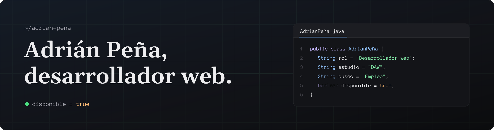

  

---

### — Sobre mí

▸ Estudiando **DAW** (Desarrollo de Aplicaciones Web)  
▸ Aprendiendo **Java**, **Spring** y **Node.js** en el backend  
▸ Por mi cuenta: webs con **Astro**, servidores **Linux** y administración de sistemas  
▸ Me interesa tanto el **diseño web** como la **lógica y arquitectura** del software  
▸ Busco **colaborar en proyectos** y dar mis primeros pasos en el sector

---

### — Tecnologías

  

---

### — Contacto

  
  
  

